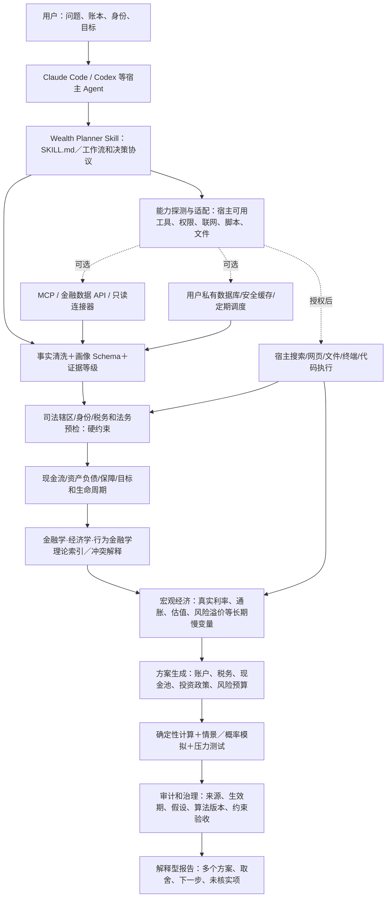

# Evidence-Based Wealth Planner Skill — 总体架构与能力缺口（v0.4 规划稿）

> 版本：架构规划稿 v0.4（**不是已实现的 v0.4 Skill**）  
> 日期：2026-10-11  
> 基线：对已交付 `finance-planner-skills_跨学科税法动态版_v0.3.zip` 的 `SKILL.md`、README、架构文档、脚本及测试进行核查；本地 46 项单元测试通过。没有在 Codex / Claude Code 中进行端到端联网与工具调用验收。

## 0. 产品定义、目标和边界

**定义**：面向不同收入、资产规模、税收居民身份、生活法域和人生阶段的跨学科、跨司法辖区、长期（10—30 年）循证个人财务规划 **Agent Skill**。由 Codex / Claude Code / 其他支持的宿主 Agent 执行工作；Skill 封装专业流程、决策政策、知识索引、验证规则、可复算数学程序与工具调用规范。

**目标函数（示意）**：在满足合法合规、基本流动性、债务义务、家庭保障、风险承受能力等硬约束的前提下，比较不同预算、税务处理方式（依法适用）、资产配置及目标路径的**税后、扣费后、通胀调整后、不同风险情景中的财富结果**，兼顾可执行性、稳健性和管理成本。不能将一个人为设定的“收益最大化”代理成全体用户的目标。

**不做**：无资质执业意见；自动报税、开户、划款、下单、修改金融账户、规避资金监管；用不完整的资料计算“确定税额”；将模型里的概率当作可验证的真实未来概率。

## 1. 三层架构：宿主、Skill、外部资源



**关键归属**：
- **宿主 Agent（Claude Code、Codex）**：语言理解、计划与调度、调用获准工具、访问许可的资料、生成最终报告。可用时使用宿主的研究、子 Agent 与终端功能，但**不能假设所有宿主支持同样的工具/名称/权限**。
- **Skill**：工作流、触发边界、事实审核、理论选择、法律约束、工具能力需求和降级规则；提供 Python 计算/验证脚本。**Skill 本身不是独立常驻进程或自有 Agent 运行时**。
- **外部数据与系统**：官方法规、条约、养老金及基金公告、宏观市场数据、获授权的金融账户（初期只读）、私有存储、审计与外部调度。**没有连接就不能自行读取，更不能臆造连接结果**。

## 2. v0.3 现状核查（已实现 ≠ 可联网端到端）

| 领域 | 已有（在 v0.3 ZIP 中核对） | 关键未实现 / 限制 | 优先级 |
|---|---|---|---|
| 可移植 Skill | `SKILL.md`、按需加载 references、示例和测试 | 宿主通用 capability probe、自动化真实触发与调用 E2E | P0 |
| 证据和经典理论 | 理论/书籍目录、12 类理论流派、7 组已知冲突、条件解释器 | 大规模结构化知识图谱、原始研究质量评分、真实冲突裁决实验 | P1 |
| 司法辖区 | CN/HK/US/TH/FR/EU 元规则检查包；`jurisdiction_router.py` | 税收居民实际判定、州/城市/税年计算、条约适用、收入类型归类与法条版本追踪 | P0 |
| 基础财务计算 | `planner.py` 现金流、储备、聚合债务、收入中断等 CNY 示例 | 多币种账本、多负债摊销、社会保障、保险、家庭现金流 | P0 |
| 长期预测 | `long_horizon.py` 10/20 年固定假设与实际购买力 | 资产收益路径、组合优化、蒙特卡洛、历史重放、财务自由真实提款模型 | P1 |
| 宏观研究 | `macro_context.py` 来源/日期/单位核验；可选 FRED CSV | 全球官方源适配器、长期资本市场假设估计、可追溯版本和缓存 | P1 |
| 编排 | `finance_workflow.py` 组合输出预检、理论比较 | 由用户请求自动生成执行计划、失败重试、工具权限探测及自动降级 | P0 |
| 四城市比较 | 深圳/上海/纽约/芝加哥独立 Excel 案例 | 模型税费程序未合入 v0.3，未做一致性逐项对账 | P0 |
| 财务数据连接 | 仅虚构 JSON 示例 | 私有账本、数据连接、明细对账、授权撤销和删除 | P1 |
| 风险治理 | 明确安全边界、若干测试 | 真实法规变更告警、建议审计数据库、专家复核和红队评估 | P0—P2 |

## 3. 主 Skill 必须具备的 10 个域内引擎

| 引擎 | 输入 | 主要决定或计算 | 输出与不能越过的边界 |
|---|---|---|---|
| 01 `profile_and_data_quality` | 城市、身份、账户、收入凭证、家庭、资产负债、目标 | 来源分类，拥有权/已到账/币种/税前税后核验，缺口识别 | `VerifiedFact` / `UserReported` / `Assumption` / `Unknown` |
| 02 `jurisdiction_and_compliance` | 税收居民、居住日数、国籍、收入发生地、银行地、持有载体、资产所在地、税年 | 可能适用的税、法律、退休/社保、投资准入、CRS/FATCA、继承、合同责任 | 许可/需核查/阻断；不是全球税率猜测器 |
| 03 `personal_cashflow` | 实际收入、固定与可变消费、资产、债务、税备付 | 净资产、自由现金流、储备月数、流动性、债务优先级 | 能投多少之前，先确定哪些钱**不能**投资 |
| 04 `life_cycle_and_goals` | 年龄、家庭成员、未来移居、教育、购房、医疗、退休年限、货币 | 分期限目标资产负债匹配（ALM）、目标金额与时间约束 | 短期目标资金不得与长期股权资金机械混用 |
| 05 `economics_and_evidence` | 原始论文、经典书籍、经济学研究、监管文件 | 识别恒等式/定理/实证/历史/经验/哲学/有效法条；适用性和冲突 | 避免“某大师说”直接成为行动命令 |
| 06 `long_term_macro` | 同币种真实利率/通胀/收益率曲线/风险溢价/估值及年份 | 生成 5/10/20/30 年多个经济情景与慢变量假设 | 历史观测≠未来预测，美元利率≠人民币收益 |
| 07 `investment_policy` | 税后可投金额、投资期限、资产负债、准入、风险承受 | 现金池、可投资工具、战略配置、再平衡、成本、税务位置、集中度 | 是方案候选和规则，不默认自动交易 |
| 08 `simulation_and_risk` | 资产回报情景、投入、税费、汇率、相关性、冲击 | 复利、真实购买力、Monte Carlo（需校准）、历史压力、收入与市场共振、退休提款 | 无校准不得输出带伪精度的成功概率 |
| 09 `decision_and_execution` | 可行方案、法律状态、目标、用户价值偏好 | 硬约束排除→目标排序→方案比较→执行与复核建议 | 高影响行动需用户确认/专业人员审核 |
| 10 `audit_and_monitoring` | 事实快照、来源、模型版本、执行记录 | 法规过期/用户重大事件/年度审查触发，差异解释 | 可复算、可撤销、最小化数据保留 |

**区分二类“代理能力”**：工作流的“任务判断和工具调用”属于宿主 Agent；定量计算、来源校验、风险规则属于显式可测试代码。不要试图把十个引擎全部包装成十个 LLM Agent。

## 4. 工具调用协议：利用宿主能力而不自带 Agent

### 4.1 跨宿主可移植 Core

`SKILL.md` 应写的是**能力需求和调用策略**，不是硬编码任何一款客户端的具体工具名称。

| 能力名（逻辑抽象） | 可用宿主能力 | 用于什么 | 不可用时 |
|---|---|---|---|
| `source_discovery` | 网络搜索/浏览器/官方文档检索 | 发现官方法规、条约、基金说明、宏观源 | 把对应结论标记“未核实”，仅提供条件式路径 |
| `source_fetch` | 网页读取/API/文件读取 | 获取**完整**法条、表格、现行税年 | 不从搜索摘要拼凑确定税负 |
| `execute_math` | Python/shell/代码运行时 | 数学计算、模拟、检验单位和公式 | 只做可人工验证的简化示例，披露限制 |
| `parse_user_files` | 文件读取/CSV/XLSX/PDF工具 | 账单/工资单导入、资产表归一化 | 使用用户手动输入，标明来源性质 |
| `authorized_account_read` | 已安装、已授权、只读金融连接器/MCP | 自动读取已到账现金流、交易与持仓 | 禁止猜测/自动登录；需要用户授权 |
| `private_state` | 本地加密存储/已授权数据库 | 保存用户画像、快照、计划与审计 | 默认一次性会话；不上传 GitHub |
| `scheduled_execution` | 系统定时器/外部工作流 | 月度复盘、法规变更检查 | 仅在本次任务执行，不声称后台持续运行 |
| `professional_handoff` | 安全导出报告及证据清单 | 高风险税务/法律/投资方案人工核查 | 保留待核实问题，不给出确定性操作建议 |

**运行时必须优先：**识别用户任务→读取宿主实际可用工具和权限→选最小必要调用→核验输出→失败降级→引用来源→记录未核实点。**Skill 不能突破宿主安全/联网/权限配置，也不能凭 `SKILL.md` 凭空安装外部连接器。**

### 4.2 可移植性

- `SKILL.md`、references、独立脚本遵循 Agent Skills 通用格式，Codex/Claude Code 共用。
- `adapters/claude-code/`：仅放 Claude Code 特有的优化/可选配置（如 forked subagent、权限提示），不可让核心逻辑依赖这些特性。
- `adapters/codex/`：仅放 Codex 特有 UI 元信息/工具权限说明；不假设同一配置能在 Claude Code 生效。
- MCP 是**数据/动作接口**，Skill 是**如何调度与解释接口的规范**；第一版完全允许没有 MCP。

### 4.3 安全权限分级

- **L0 读取公开资料**：可在宿主权限允许时自动操作；留下来源和日期。
- **L1 读取个人敏感资料**：用户明确授权、最小权限、本地/私有处理。
- **L2 写入私有规划状态**：征得同意、保存变更记录。
- **L3 金融划款/证券交易/申报税务/向第三方发送敏感资料**：默认禁止自动化；需单独的受控产品、明确许可、法规核验与相应审批。

## 5. 统一输入数据模型（至少这些字段）

```json
{
  "as_of": "2026-10-11",
  "person": {
    "age": null,
    "household": "single",
    "tax_residency_claims": ["CN"],
    "citizenships": ["CN"],
    "residence": {"country": "CN", "region": "Guangdong", "city": "Shenzhen"},
    "days_by_jurisdiction": {},
    "planned_relocation": null
  },
  "income": [{"type": "employment", "currency": "CNY", "gross_monthly": 20000, "realized": true, "tax_treatment": "unknown", "source_confidence": "user_reported"}],
  "household_finances": {
    "essential_spending_monthly": null,
    "discretionary_spending_monthly": null,
    "assets": [],
    "liabilities": [],
    "insurance": [],
    "pension_and_restricted_assets": []
  },
  "goals": [{"type": "retirement", "target_date": null, "spending_currency": "CNY"}],
  "risk": {"capacity": "unknown", "willingness": "unknown", "drawdown_limit": null},
  "consents": {"use_user_files": false, "connect_accounts": false, "persist": false}
}
```

**所有金额保留原始币种与估值时间**，多币种合计必须绑定有日期的汇率及换算方法。原始银行到账额、税前收入、报税后净收入、PF模拟余额、受限制退休资产、个人自有投资账户不可互相替代。

## 6. 统一的工作流状态机

1. `INTAKE`：识别问题与必要输入，不要求不相关隐私。
2. `CAPABILITY_CHECK`：探测宿主是否联网/具备终端/API/文档阅读/MCP；若能力缺失，选择降级模式。
3. `FACT_VERIFICATION`：工资、PF出金、资产负债、法域、税年、币种、来源可信度；缺失点显性化。
4. `JURISDICTION_GATE`：是否能对收入性质、纳税主体、投资渠道作出确定判断？否则返回待核实路径。
5. `HOUSEHOLD_SOLVENCY`：税前税后、生活费、现金储备、债务与保障，得出可支配/可投资现金流。
6. `GOAL_AND_LIFECYCLE`：目标期限、购房、教育、退休、继承、跨国迁徙与负债匹配。
7. `EVIDENCE_RESEARCH`：在相关理论中挑选证据，并调和或保留理论冲突。
8. `MACRO_SCENARIOS`：更新长期慢变量；记录观测与预测之间的推断。
9. `CANDIDATE_PLANS`：至少生成基准与保守（可加增长）两类可行方案。
10. `DETERMINISTIC_AND_STOCHASTIC_VALIDATION`：统一税费和现金流口径；先数学守恒、再压力测试、最后在校准基础上估计分布。
11. `POLICY_CHECK`：核查资金流动性、投资准入、证据、风险、法务、用户权限；高风险问题必须人工复核。
12. `EXPLAIN_AND_MONITOR`：报告差异、每月/每年复核项目、模型/资料版本与无法核实的信息。

**重算触发**：收入持续变化、搬家或跨境居住、结婚/离婚、子女、重大医疗/债务、法规生效、偏离目标的资产负债、长期资本市场假设重大变化。**单月市场波动 ≠ 自动改变战略资产配置**。

## 7. 理论证据治理与冲突决策

**知识索引的基本单位**不应是一本书，而是一个可验证命题 `claim`：`来源＋页码/章节（若有）＋理论类型＋适用条件＋样本时间与地区＋数学假设＋反例＋置信判断＋版本＋对应决策`。不在开源仓库内分发受版权保护的完整书籍。

证据类别：会计恒等式与数学结论／带假设的定理／历史实证与统计研究／可复现自然实验或行为干预／职业经验法则／投资哲学与价值判断／当前生效法律（须官方核实）。它们不能靠“投票”互相替代。

**冲突裁定顺序**：
1. 依法是否可做（本国、他国、条约、州/城市、相关税年）；不清楚则阻断确定性法律/税务结论。
2. 是否支付得起、是否能生存、是否影响基本保障。
3. 是否与用户资产负债和投资期限匹配。
4. 是否有可靠证据、在目标地区和时间可迁移。
5. 税后、扣费、扣通胀的长期风险收益，以及执行成本和个人行为约束。
6. 在余下多个合理方案中呈现偏好差异，而不是强制推导“唯一最优”。

**典型理论关系**：格雷厄姆价值投资 vs 博格尔指数（条件冲突）；马科维茨分散 vs 塔勒布尾部风险（互补）；生命周期平滑 vs 高收益但不稳定收入（要建人力资本与破产风险）；Bengen 提款模型 vs 不同国家社保/税法（仅作为假设起点）；行为经济学自动化 vs 现金安全/客户控制（需要可撤销、限额的自动化）。

## 8. 长期宏观与投资假设的角色边界

- **低频慢变量**：本币通胀与通胀预期、本币实际利率/期限结构、国内外企业盈利/生产率、长期估值、风险溢价、主要投资品种的真实费用、税制与制度风险。
- **明确区分**：历史观测、估值隐含、研究机构预测、系统假设、用户主观预期；不得把美国 TIPS 长期实际收益替换成中国居民的人民币无风险回报。
- **不以新闻频繁调仓**：季度或年度更新长期资本市场假设，除非存在税制、投资渠道、资产负债或风险边界的实质变化。
- **资产负债主导风险预算**：10 年前要用的房屋首付、半年基本生活费与 20 年后养老金适合不同风险桶。
- **在估值与利率变动下比较方案**：反事实分析“如果真实利率长期偏高/股权风险溢价偏低/通胀超预期/工资中断六个月，目标概率及需要储蓄率如何变化？”

## 9. 完整报告的机器可读契约

每次规划至少返回以下模块（允许因权限和信息缺失而写 `blocked` / `not_verified`）：

```text
run_id, model_version, skill_version, as_of
user_facts[{field, value, currency, source, verified_at, confidence}]
jurisdiction_map[{contact, country, state, city, tax_year, status}]
legal_tax_review[{claim, official_source, effective_date, confidence, unresolved}]
financial_health{income_realized, taxes_reserved, cash_runway, liabilities, investable_monthly}
asset_liability_schedule[{goal, currency, amount, date, priority, funding}]
capital_market_assumptions[{asset, currency, horizon, source, as_of, estimated_range}]
scenarios[{name, assumptions, nominal_wealth, real_wealth, downside_metrics, goal_status}]
policy_options[{id, conditions, allocations, accounts, fees, tax_risks, liquidity, rebalance}]
evidence_and_conflicts[{theory_or_rule, evidence_class, applicability, conflict, resolution}]
action_plan[{action, urgency, can_execute, approval_level, owner}]
uncertainties[], blocked_decisions[], monitoring_triggers[], reproducibility{inputs_hash, code_version, source_snapshot}
```

**检验标准**：同样输入与版本，确定性计算一致；不能用无法核实的税率生成“精确最优组合”；无法联网时不能使用过期法规伪装成当前法规；报告必须区分确定事实、模型假设和价值判断。

## 10. 建议的仓库架构（目标，不是 v0.3 已有目录）

```text
wealth-planner-skills/
├── README.md
├── LICENSE
├── docs/
│   ├── ARCHITECTURE.md
│   ├── EVIDENCE_POLICY.md
│   ├── SECURITY_AND_PRIVACY.md
│   └── EVAL_PLAN.md
├── skills/
│   └── personal-wealth-planner/
│       ├── SKILL.md                       # 简洁通用入口 / 决策路由
│       ├── workflows/                    # intake, crossborder, plan, review
│       ├── references/                   # 各学科理论、法律研究规范、检验条件
│       ├── jurisdictions/                # 法域目录与适用判定规范（非全球税率缓存）
│       ├── policies/                     # 证据分级、冲突裁决、行动权限
│       ├── scripts/                      # CLI：校验、调用独立核心包
│       └── assets/                       # 用户可复制的报告模板，虚构样例
├── wealth_core/                          # 与 LLM/客户端解耦的 Python 包
│   ├── schema/                           # Pydantic / JSON Schema
│   ├── calculations/                     # 账本、税后现金流、ALM、费率、真实收益
│   ├── simulations/                      # 历史情景、随机路径、退休提款
│   ├── jurisdictions/                    # 经验证的按税年/法域 tax plugins
│   └── validation/                       # 数据质量、公式守恒、可投资资格限制
├── adapters/                             # 各宿主可选适配，不污染标准 Skill
│   ├── codex/
│   ├── claude-code/
│   └── mcp/                              # 只读连接器，未来可选
├── data_registry/                        # 公开来源索引/版本/许可，不放个人资料
├── tests/
│   ├── unit/
│   ├── integration/
│   ├── golden_cases/                     # 深圳、上海、纽约、芝加哥等假设案例
│   └── host_e2e/                         # 在真实 Codex/Claude Code 中验证
└── .github/workflows/
```

开源仓库存**通用方法与代码**；用户账本和凭证放本地或私有后端，默认不上传云端。

## 11. 实现顺序：优先建立可信的调用系统，而不是无限增加理论

| 阶段 | 交付物 | 验收门槛 |
|---|---|---|
| **v0.4（最近一版）** | 宿主能力探测/调用约定、权限/失败降级、统一用户画像与货币/来源 Schema、独立 CLI、4 城市金标准案例及 v0.3 逐项校对 | Codex/Claude Code 安装→触发→实际读取官方来源/或正确阻断→调用 Python→形成可追溯报告，重复运行数值一致 |
| **v0.5** | 深圳、上海、纽约、芝加哥/中国与美国基础税务、社保/401(k)及税年规则的**有限范围**、官方来源和计算版本 | 案例与法规逐条对账，边界测试，假设税务身份变化能触发重算 |
| **v0.6** | 多币种账本、债务和养老金、短中长期分桶、IPS、资产配置与成本比较、税后现金流和真实购买力 | 输出“可投资金额”“资产配置”全链条数值闭合，债务/养老金/币种无重复计入 |
| **v0.7** | 长期资本市场假设研究引擎、历史重放、带校准的风险模拟及收益顺序风险 | 独立模型验证、敏感性分析、误差和不确定性披露，不能制造虚假精度 |
| **v0.8—1.0** | 审批式只读账户连接、私有状态、法规/家庭事件驱动复盘、安全与合规评估、更多法域插件 | 用户授权可撤回、数据可导出/删除、审计可追溯，符合目标地区监管与隐私要求 |

**不建议**：初期开发独立多 Agent 平台、自动交易、全球税法全覆盖、把所有经典著作原文塞入上下文，或对跨国复杂税务给未核实的确定结论。

## 12. 四城验收问题示例

- **深圳 2 万元/月税前**：是否识别到个税与社保公积金对现金流/净资产的不同影响？是否要求或核验专项扣除资格？
- **上海 2 万元/月税前**：是否按当地生效年份处理社保、住房成本及可支配现金流，而不是照搬深圳参数？
- **纽约 2 万美元/月税前**：是否区分联邦、纽约州与纽约市税，及401(k)、医保和税后美元现金流？是否核验实际的身份、福利、税年？
- **芝加哥 2 万美元/月税前**：是否识别伊利诺伊州税制，不凭空征收纽约市税？住房成本是否来自用户输入或明确的预算假设？
- **跨境 PF 例子**：是否始终分离实收款、模拟利润、税收居民、收入来源、银行卡、平台和合同管辖法律？
- **工具不可用**：不能假装已抓到当前利率或最新税法；必须输出未核实源、条件模拟和后续核验路径。
- **理论冲突**：不是机械选择著名人物观点；解释何时 Bogle 低成本多元化更合适，Graham 主动估值有何证据门槛，并明确法律禁止与理论偏好不能相互抵消。

## 13. 长期系统的核心原则（决策金字塔）

**目标**：以可接受的风险和管理成本，提高真实、税后、扣费后购买力与生命周期财务目标的稳健实现能力。

**约束层**：合法持有/纳税/投资准入 → 家庭现金安全与负债 → 投资期限与实际货币 → 可承受亏损 → 信息与方法可信度。

**研究层**：经济学解释环境 → 财务理论设计候选 → 行为金融提高执行 → 统计与数学检验可行性 → 法税研究确认实际可做事项。

**实施层**：提出多方案 → 计算并比较 → 用户确认 → 必要时专业复核 → 定期更新事实与假设 → 保留审计和纠错记录。

**一句话**：**让 Claude Code / Codex 做“可调用工具的大脑”，让 Skill 做“专业财务方法与执行协议”，让可复算程序做“计算器”，让官方来源做“时效性法律事实依据”，让用户掌握最终决策权。**
